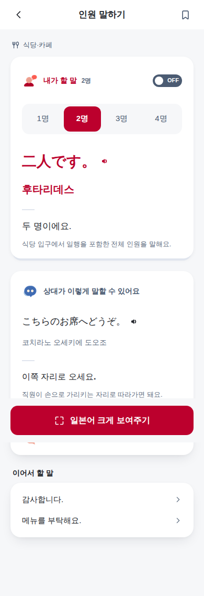

  <picture>
    <source media="(max-width: 640px)" srcset="assets/diagrams/hero-mobile.svg">
    
  </picture>

# NIHON

일본어가 서툰 한국인 여행자를 위한 모바일 회화 도구입니다. 
식당 직원이 인원을 물으면 **후타리데스**를 따라 읽거나 휴대폰에 **二人です。**를 크게 띄워 보여주면 됩니다. 
식당·카페, 편의점·쇼핑, 교통·길찾기, 숙소, 공항, 도움 요청까지 여섯 가지 상황을 담았습니다. 

**[NIHON 열기 ↗](https://nihon.today/)** · [두 명이라고 말해 보기](https://nihon.today/phrases/dining-party/?variant=p2) · [측정·검증 기록](docs/VALIDATION.md)

  

## 다섯 탭의 이용 흐름

<picture>
  <source media="(max-width: 640px)" srcset="assets/diagrams/service-flow-mobile.svg">
  
</picture>

 

탭별 기능과 바로가기

| 탭 | 들어가서 할 수 있는 일 |
| --- | --- |
| [상황](https://nihon.today/) | 상황이나 검색어로 표현 찾기 · 인원 고르기 · 듣거나 크게 보여주기 · 출발 전 연습 · 오프라인 준비 |
| [대화](https://nihon.today/translate/) | 내가 말하기 / 상대가 말하기 → 한 문장씩 음성 번역 · 일본어 다시 듣기 · 대화 기록 비우기 |
| [번역](https://nihon.today/translate/text/) | 한국어·일본어 입력 · 번역 · 복사 · 일본어 듣기 · 원문 수정과 복원 |
| [저장](https://nihon.today/saved/) | 인원별로 저장한 표현 보기 · 같은 문장 다시 열기 · 저장 해제 |
| [MY](https://nihon.today/my/) | 내가 할 말 / 상대의 말 → 다섯 목소리 미리 듣기 → 고른 역할에 설정 |

 

### 식당 입구에서 주고받는 세 마디

‘지금 들어갈 수 있나요?’를 열고 일본어를 누르면 발음이 나옵니다. 
직원이 인원을 물으면 **‘상대가 이렇게 말할 수 있어요’**에서 ‘몇 분이세요?’를 펼쳐 ‘두 명이에요.’를 고릅니다. 
한글로 ‘두 명’을 검색해도 같은 문장을 듣거나 저장할 수 있습니다. 
직원에게 크게 보여줄 때도 두 명에 맞는 일본어가 뜹니다. 

 

### 한글 발음을 따라 읽는 법

‘カードで’는 **카아도데**라고 적습니다. 
긴 모음은 풀어 쓰고 조사는 앞말에 붙였습니다. 
**발음 표시**를 켜면 길게 읽을 모음과 이어 읽을 구간, 잠깐 멈출 받침이 보입니다. 
여행자와 상대의 발음 모두 같은 기준으로 적었습니다. 

 

실제 앱 화면 두 장 보기

  
  

[식당 입구에서 첫마디 꺼내기 ↗](https://nihon.today/phrases/dining-table/)

  

## 출발 전에 챙기는 회화와 목소리

**출발 전 10문장**에서는 한국어 뜻을 보고 할 말을 먼저 떠올린 뒤 일본어를 펼칩니다. 
여행자가 고르는 표현은 74개, 상대가 할 만한 말은 60개입니다. 
식당에서 인원을 말할 때는 읽는 법이 달라 1~4명에 맞는 문장을 따로 적었습니다. 
이렇게 모은 회화가 모두 137문장입니다. 

 

### 인터넷이 끊겨도 들을 수 있게

MY에서 다섯 목소리를 들어 보고 내 말과 상대의 말을 누가 읽을지 고릅니다. 
온라인에서 **이 기기에 준비하기**를 한 번 누르면 회화와 내가 고른 목소리의 MP3 137개를 내려받습니다. 
기본 조합인 마이와 니세의 음원은 약 4.72MB입니다. 
준비를 마치면 인터넷이 끊겨도 처음 여는 회화에서 양쪽 목소리를 들을 수 있습니다. 

[출발 전 10문장 ↗](https://nihon.today/practice/) · [인터넷 없이 준비하기 ↗](https://nihon.today/prepare/)

  

## 기기에서 찾는 회화, 온라인으로 주고받는 말

<picture>
  <source media="(max-width: 640px)" srcset="assets/diagrams/architecture-mobile.svg">
  
</picture>

 

브라우저는 Vercel에서 Next.js 정적 화면을 받아 수록 회화를 검색합니다. 
저장한 표현과 대화 기록은 이 기기의 `localStorage`에 남고, 오프라인으로 쓸 화면과 음원은 서비스 워커가 `Cache Storage`에 담습니다. 

 

**번역 탭**에 한국어나 일본어를 입력하면 먼저 앱에 수록된 문장을 찾아봅니다. 
직접 쓴 문장이 목록에 없으면 Vercel의 `text-translation` 함수가 Azure Translator에 보내고 번역문을 돌려줍니다. 
**대화 탭**에서 ‘내가 말하기’는 한국어를 일본어로, ‘상대가 말하기’는 일본어를 한국어로 옮깁니다. 
Vercel의 `speech-token` 함수가 Azure에서 임시 토큰을 받아 브라우저에 건네면, 브라우저가 Azure Speech에 직접 연결해 마이크 음성을 보냅니다. 
대화·번역 탭에서 일본어를 눌러 다시 들을 때도 Azure Speech를 씁니다. 

 

### 탭을 닫았다 다시 열 때

대화에서 한 문장을 번역할 때마다 원문과 번역문이 이 브라우저에 함께 남습니다. 
번역 탭에서는 쓰던 문장이나 마지막 번역 결과를 다시 볼 수 있습니다. 
대화 목록은 ‘비우기’를 눌러 지울 수 있습니다. 
진동을 지원하는 기기에서는 표현을 저장하거나 번역문을 복사하면 짧게 한 번 진동합니다. 

[음성으로 대화하기 ↗](https://nihon.today/translate/) · [텍스트 번역 열기 ↗](https://nihon.today/translate/text/)

  

## 재생 버튼을 누르기 전에 MP3 받기

처음에는 재생 버튼을 누르고 나서야 MP3를 받았습니다. 
그래서 **지금 고른 인원의 문장과 펼쳐 둔 상대 답변**은 회화 화면이 뜰 때 미리 내려받도록 바꿨습니다. 
문장을 누르면 미리 준비한 오디오로 재생합니다. 
MY에서 목소리를 고를 때도 들어 보려는 후보의 예문 하나만 미리 받습니다. 

 

<picture>
  <source media="(max-width: 640px)" srcset="assets/diagrams/performance-mobile.svg">
  
</picture>

 

‘두 명이에요.’의 음원을 미리 준비하자, 버튼을 누른 뒤 첫 소리가 나기까지 **325ms 걸리던 시간이 11ms로 줄었습니다(314ms 단축).** 
로컬 Chrome에서 MP3 요청을 300ms 늦추고 문장이 뜬 뒤 800ms 기다렸다가 눌렀습니다. 
두 빌드에서 다섯 번씩 재고 중앙값을 비교했습니다. 
화면을 열자마자 누르면 다운로드를 기다릴 수 있고, 데이터 절약 모드에서는 누른 다음에 음원을 받습니다. 

[측정 조건과 최신 커밋의 검증 결과](docs/VALIDATION.md)

  
